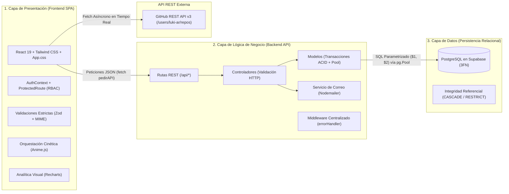
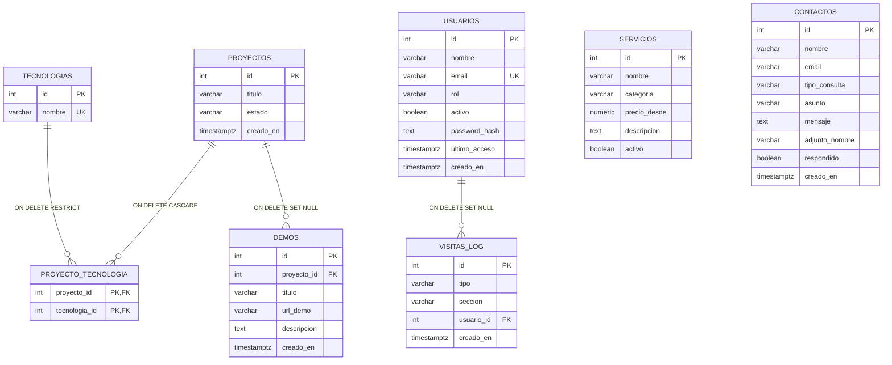

# Arquitectura del Sistema — Plataforma Full-Stack LOTUS.

**Asignatura:** Lenguajes IV — Trabajo Final Integrador (Nivel Promoción Directa)  
**Equipo de Desarrollo:** Lucas Colque, Mauricio Navarro, Gabriel Vargas, Pilar Alvarado  

---

## 1. Arquitectura en 3 Capas (Three-Tier Architecture)

El sistema **LOTUS.** implementa de forma estricta una **arquitectura en 3 capas**, garantizando alta cohesión, bajo acoplamiento y separación clara de responsabilidades entre la interfaz de usuario, las reglas de negocio y el motor relacional de base de datos:



---

## 2. Stack Tecnológico Detallado

### 2.1. Capa de Presentación (Frontend)
- **React 19 (`react`, `react-dom`):** Arquitectura declarativa basada en componentes funcionales y hooks (`useState`, `useEffect`, `useLayoutEffect`, `useCallback`, `useRef`, `useContext`).
- **React Router DOM v7:** Enrutamiento SPA sin recarga de página con segregación entre rutas públicas (`/`, `/perfil`, `/contacto`, `/login`), rutas autenticadas (`/repositorios`) y rutas exclusivas de Administrador (`/gestion`, `/contactos-admin`, `/dashboard`).
- **Tailwind CSS + CSS Custom Properties (`src/App.css`):** Sistema de diseño *Obsidian Botanical Luxury* con glassmorphism, watermark SVG de flor de loto y adaptabilidad Mobile-First.
- **Zod (`src/utils/validaciones.js`):** Validación rigurosa de esquemas en los **7 formularios** del sistema (textos, regex de nombres, emails, URLs seguras `http/https`, precios numéricos y validación de archivos adjuntos por extensión, tipo MIME y tamaño máximo de 5 MB).
- **Recharts:** Visualización de datos en el Dashboard con 3 gráficos interactivos (*BarChart* diario, *PieChart* de distribución de catálogo 3FN y *BarChart* de rendimiento por sección).
- **Anime.js (`src/utils/animaciones.js`):** Animaciones de entrada orquestadas en múltiples etapas mediante `anime.timeline()`, curvas físicas `spring(1, 80, 10, 0)` y cascadas `anime.stagger()`.

### 2.2. Capa de Lógica de Negocio (Backend)
- **Node.js + Express 4:** API RESTful estructurada bajo el patrón *Routes → Controllers → Models → Middlewares*.
- **Driver `pg` (`Pool` en `backend/src/config/db.js`):** Pool de conexiones persistentes hacia Supabase (Session Pooler IPv4 con SSL), soporte de **transacciones ACID** (`withTransaction`: `BEGIN` → `COMMIT` / `ROLLBACK`) y ejecución de consultas paralelas (`Promise.all`).
- **Seguridad y Autenticación (`crypto.scryptSync`):** Hash criptográfico de contraseñas y verificación de estado de cuenta (`activo = true/false`) y rol (`Cliente`, `Colaborador`, `Administrador`).
- **Nodemailer (`backend/src/utils/mailer.js`):** Envío de correos transaccionales al recibir consultas o solicitudes de cotización desde el formulario de contacto, con fallback seguro a transporte JSON local si no se configuran credenciales SMTP externas.
- **Traductor de Errores SQL (`backend/src/middlewares/errorHandler.js`):** Intercepta errores nativos de PostgreSQL (`23505` *unique_violation*, `23001`/`23503` *foreign_key_violation*, `23514` *check_violation*) y los transforma en respuestas HTTP semánticas (`409 Conflict`, `400 Bad Request`, `404 Not Found`).

### 2.3. Capa de Datos (PostgreSQL / Supabase)
- **Normalización en Tercera Forma Normal (3FN):** Separación de entidades para evitar redundancia de datos (por ejemplo, catálogo único de `tecnologias` vinculado N:M con `proyectos` a través de `proyecto_tecnologia`).
- **Consultas Parametrizadas (`$1, $2`):** Todas las lecturas, escrituras y filtros analíticos utilizan parámetros posicionales del protocolo `pg`, previniendo de raíz cualquier ataque de **Inyección SQL (SQLi)**.

---

## 3. Modelo Entidad-Relación (ERD) e Integridad Referencial



### Reglas de Integridad Referencial Declarativa (`backend/db/schema.sql`)
1. **`ON DELETE CASCADE` (`proyecto_tecnologia.proyecto_id → proyectos.id`):** Al eliminar un proyecto, se limpian automáticamente sus vínculos en la tabla intermedia sin afectar el catálogo maestro de tecnologías.
2. **`ON DELETE RESTRICT` (`proyecto_tecnologia.tecnologia_id → tecnologias.id`):** Impide borrar una tecnología que esté siendo utilizada por algún proyecto activo.
3. **`ON DELETE SET NULL` (`demos.proyecto_id → proyectos.id` y `visitas_log.usuario_id → usuarios.id`):** Preserva las demos independientes y el historial estadístico de visitas aunque se elimine el proyecto o el usuario original.

---

## 4. Especificación de APIs (REST Interna + Externa)

### 4.1. Endpoints de la API REST Propia (`/api/*`)

| Módulo | Método y Ruta | Descripción Técnica |
| :--- | :--- | :--- |
| **Healthcheck** | `GET /api/health` | Verifica conectividad activa entre Express y PostgreSQL (`SELECT 1`). |
| **Proyectos (N:M)** | `GET /api/proyectos`<br>`POST /api/proyectos`<br>`PUT /api/proyectos/:id`<br>`DELETE /api/proyectos/:id` | Lista proyectos con `json_agg` de tecnologías. El alta y edición ejecutan **transacciones ACID** que insertan/reutilizan tecnologías (`ON CONFLICT DO NOTHING`) y vinculan `proyecto_tecnologia`. |
| **Tecnologías** | `GET /api/tecnologias`<br>`POST /api/tecnologias`<br>`DELETE /api/tecnologias/:id` | ABM del catálogo de tecnologías con índice único `lower(nombre)`. |
| **Demos** | `GET /api/demos`<br>`POST /api/demos`<br>`DELETE /api/demos/:id` | Gestión de demos interactivas con `LEFT JOIN` al título del proyecto vinculado. |
| **Servicios** | `GET /api/servicios`<br>`POST /api/servicios`<br>`PATCH /api/servicios/:id/estado`<br>`DELETE /api/servicios/:id` | Catálogo de prestaciones profesionales con alternancia de disponibilidad (`activo`). |
| **Usuarios y Auth** | `GET /api/usuarios?rol=$1`<br>`POST /api/usuarios`<br>`POST /api/usuarios/registro`<br>`POST /api/usuarios/login`<br>`PATCH /api/usuarios/:id/rol`<br>`PATCH /api/usuarios/:id/estado`<br>`DELETE /api/usuarios/:id` | Padrón de usuarios filtrable por rol (`$1`), autenticación `scrypt` con registro transaccional de acceso en `visitas_log`, cambio de rol en vivo (`Cliente` / `Colaborador` / `Administrador`) y suspensión de cuentas. |
| **Contactos + Email** | `GET /api/contactos`<br>`POST /api/contactos`<br>`PATCH /api/contactos/:id/respondido`<br>`DELETE /api/contactos/:id` | Persiste la consulta en PostgreSQL, dispara notificación vía **Nodemailer** y permite al Administrador marcar mensajes como respondidos. |
| **Métricas y BI** | `GET /api/metricas?dias=$1&seccion=$2`<br>`POST /api/metricas/visita` | Ejecuta 4 consultas SQL parametrizadas en paralelo (`Promise.all`) con `generate_series` para alimentar los KPIs y los 3 gráficos interactivos de Recharts. |

### 4.2. Consumo de API Externa en Tiempo Real
- **GitHub REST API (`src/components/ProyectosAPI.jsx`):** Consume `GET https://api.github.com/users/luki-ar/repos?sort=updated`, sincronizando en tiempo real los repositorios públicos del equipo dentro de la sección protegida `/repositorios`.

---

## 5. Estructura de Directorios del Proyecto

```text
tp10/
├── MANUAL_ESTILO.md               # Anteproyecto: Paleta #HEX, tipografía, prototipado y responsividad
├── ARQUITECTURA.md                # Documentación de arquitectura en 3 capas, ERD 3FN y APIs
├── DESPLIEGUE.md                  # Guía DevOps paso a paso (Vercel + Render + Supabase)
├── SKILL.md                       # Directrices de diseño cinético con Anime.js
├── vercel.json                    # Regla de SPA Rewrite para despliegue en Vercel
├── render.yaml                    # Blueprint Infrastructure-as-Code para despliegue en Render
├── .env.example                   # Plantilla de variables de entorno del Frontend
├── package.json                   # Dependencias y scripts del Frontend (React 19, Recharts, Zod, Anime.js)
├── public/
│   └── index.html                 # Plantilla base con Tailwind CSS y fuente Google Fonts (Poppins)
├── src/
│   ├── App.js                     # App Shell, LotusWatermark, Navbar responsivo, Rutas RBAC y CRUD Proyectos
│   ├── App.css                    # Sistema de tokens CSS, Glassmorphism, Hover CSS y Media Queries
│   ├── utils/
│   │   ├── animaciones.js         # Adaptador de Anime.js (timeline, stagger, spring, cubicBezier)
│   │   └── validaciones.js        # Esquemas Zod para los 7 formularios + validador MIME/tamaño de archivos
│   └── components/
│       ├── ProtectedRoute.jsx     # Guardián RBAC (Contexto de sesión, redirección Login y bloqueo 403)
│       ├── ProyectosAPI.jsx       # Consumo asíncrono de la API pública de GitHub
│       ├── SeccionesPublicas.jsx  # Perfil Profesional, Formulario de Contacto, Auth y Catálogo Protegido
│       └── AdminModulos.jsx       # Módulos Admin: Demos, Servicios, Usuarios, Contactos y Dashboard Recharts
└── backend/
    ├── package.json               # Dependencias y scripts del Backend (Express, pg, cors, dotenv, nodemailer)
    ├── .env.example               # Plantilla de variables de entorno del Backend (Supabase + SMTP)
    ├── db/
    │   └── schema.sql             # Script DDL idempotente en 3FN + claves foráneas + datos semilla
    └── src/
        ├── server.js              # Punto de entrada HTTP con manejo de puerto y señales de proceso
        ├── app.js                 # Configuración Express, CORS, JSON parser, /api/health y rutas
        ├── config/
        │   └── db.js              # Configuración de pg.Pool (SSL) y helper transaccional ACID (withTransaction)
        ├── middlewares/
        │   └── errorHandler.js    # Traducción centralizada de errores PostgreSQL a códigos HTTP
        ├── utils/
        │   ├── http.js            # Clases HttpError, parseId y wrapper asyncHandler
        │   └── mailer.js          # Transporte SMTP con Nodemailer y fallback seguro JSON
        ├── models/                # Capa de Acceso a Datos (SQL parametrizado $1, $2)
        │   ├── proyecto.model.js
        │   ├── tecnologia.model.js
        │   ├── demo.model.js
        │   ├── servicio.model.js
        │   ├── usuario.model.js
        │   ├── contacto.model.js
        │   └── metrica.model.js
        ├── controllers/           # Capa de Controladores REST
        └── routes/                # Definición de Enrutadores Express
```
