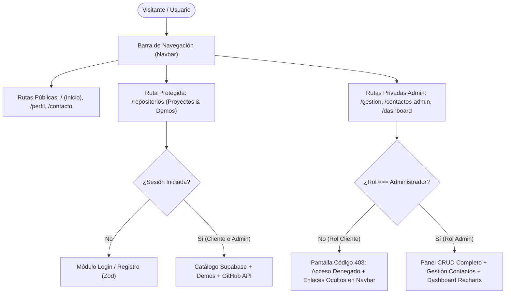

# Anteproyecto: Manual de Marca, Diseño y Estilo UI/UX — Portfolio LOTUS.

**Asignatura:** Lenguajes IV — Trabajo Final Integrador (Nivel Promoción Directa)  
**Proyecto:** Plataforma Web Full-Stack & Portfolio Profesional **LOTUS.**  
**Equipo de Desarrollo:** Lucas Colque, Mauricio Navarro, Gabriel Vargas, Pilar Alvarado  

---

## 1. Concepto de Marca y Dirección Estética

El sistema de diseño de **LOTUS.** se fundamenta en la dirección estética **Obsidian Botanical Luxury & Dark Glass Engineering**:
- **Identidad Simbólica (La Flor de Loto):** Representa pureza arquitectónica, precisión geométrica y resiliencia técnica emergiendo sobre una superficie oscura profunda. Se materializa visualmente mediante un **Watermark SVG Geométrico de Flor de Loto** (`.lotus-watermark-bg`) fijo en la atmósfera de fondo y en el emblema luminoso del logotipo (`LOTUS.`).
- **Cristal Esmerilado y Luz Bioluminiscente (Glassmorphism):** Las superficies utilizan desenfoque de fondo (`backdrop-filter: blur(16px)`) y un borde especular superior (`::before`) con gradiente índigo-magenta que simula iluminación de estudio sobre cristal oscuro.

---

## 2. Paleta de Colores (`#HEX`)

La paleta cromática está definida mediante variables CSS globales (`:root` en [`src/App.css`](src/App.css)) y calibrada para superar los estándares de contraste **WCAG 2.2 Nivel AA/AAA** (`>= 4.5:1` en texto normal y `>= 7:1` en titulares).

### 2.1. Colores de Fondo y Superficie (Base Oscura)

| Categoría | Token CSS | Código `#HEX` | Valor RGBA / Gradiente | Aplicación en la Interfaz |
| :--- | :--- | :--- | :--- | :--- |
| **Fondo Primario** | `--bg-dark` | `#050508` | `rgb(5, 5, 8)` | Lienzo principal OLED Obsidian de toda la aplicación. |
| **Superficie Nivel 1** | `--surface-1` | `#10121C` | `rgba(16, 18, 28, 0.74)` | Fondo translúcido base de tarjetas `.card-proyecto` y contenedores. |
| **Superficie Nivel 2** | `--surface-2` | `#181B2A` | `rgba(24, 27, 42, 0.86)` | Estado elevado de tarjetas, barra de navegación `.navbar` y modales. |
| **Fondo de Inputs** | `--input-bg` | `#080A12` | `rgba(8, 10, 18, 0.68)` | Campos de texto, selectores y áreas de texto (`.input-form`). |

### 2.2. Colores Primarios, Secundarios y de Acento

| Categoría | Token CSS | Código `#HEX` | Rol Visual y Funcional |
| :--- | :--- | :--- | :--- |
| **Primario de Marca (Indigo)** | `--accent-1` | `#6366F1` | Botones primarios, anillos de foco accesible (`:focus-visible`), bordes activos y serie principal de gráficos. |
| **Secundario de Marca (Lotus Rose)** | `--accent-2` | `#EC4899` | Identidad de la Flor de Loto, insignias del Rol Administrador, acentos de gradiente y serie de *Usuarios Registrados* en Recharts. |
| **Acento Terciario (Electric Blue)** | `--accent-3` | `#3B82F6` | Enlaces interactivos, transiciones de botones primarios y serie de *Visitas Generales* en el Dashboard. |
| **Acento Luminoso (Sky Cyan)** | `--accent-sky` | `#38BDF8` | Insignias de integración externa (GitHub API) e identificador del Rol Cliente. |
| **Acento Floral (Soft Pink)** | `--lotus-pink` | `#F472B6` | Tramo final del gradiente tipográfico `.text-gradient` (`#60A5FA` → `#818CF8` → `#F472B6`). |

### 2.3. Tipografía y Estados Semánticos (`#HEX`)

| Categoría | Código `#HEX` | Ratio Contraste (vs `#050508`) | Uso Específico |
| :--- | :--- | :--- | :--- |
| **Texto Primario (`--text-main`)** | `#F8FAFC` | `19.4 : 1` (AAA) | Títulos `h1`, `h2`, `h3`, valores numéricos de KPIs y nombres de proyectos. |
| **Texto Secundario (`--text-secondary`)** | `#CBD5E1` | `13.6 : 1` (AAA) | Labels de formularios (`.label-form`), chips tecnológicos (`.tag-tecnologia`) y cabeceras de tabla. |
| **Texto Atenuado (`--text-muted`)** | `#94A3B8` | `7.2 : 1` (AAA) | Párrafos descriptivos, subtítulos y metadatos secundarios. |
| **Semántico Éxito (Success)** | `#4ADE80` | `11.8 : 1` (AAA) | Servicios activos, sesión iniciada, archivos validados y mensajes respondidos. |
| **Semántico Advertencia (Warning)** | `#FACC15` | `13.4 : 1` (AAA) | Consultas de contacto pendientes de respuesta en el panel Admin. |
| **Semántico Peligro / Error (Danger)** | `#EF4444` / `#F87171` | `5.8 : 1` (AA) | Alertas de validación estricta (Zod), pantalla `403 Acceso Denegado` y botones destructivos. |

---

## 3. Tipografía y Jerarquía Visual

- **Familia Tipográfica:** `'Poppins', system-ui, -apple-system, sans-serif` (cargada desde Google Fonts en [`public/index.html`](public/index.html)).
- **Justificación de Elección:** *Poppins* es una fuente geométrica sans-serif de alta legibilidad en pantallas oscuras cuyos trazos circulares armonizan con la geometría de la flor de loto en encabezados (`700`–`800`), manteniendo neutralidad técnica en párrafos y tablas (`400`–`500`).
- **Disciplina Numérica:** Se aplica `font-variant-numeric: tabular-nums` (`.tabular-nums`) en precios en USD, contadores de visitas, fechas y métricas para garantizar alineación vertical perfecta.

### Escala y Jerarquía Tipográfica

| Nivel Jerárquico | Elemento / Clase | Peso (`font-weight`) | Tamaño (`font-size`) | Interlineado / Tracking | Uso en el Sistema |
| :--- | :--- | :--- | :--- | :--- | :--- |
| **Display Hero (`H1`)** | `.hero-title` | `800 (ExtraBold)` | `clamp(2.15rem, 5vw, 3.65rem)` (`34px–58px`) | `line-height: 1.14` / `-1.2px` | Titular principal de portada con palabra clave en `.text-gradient`. |
| **Título de Página (`H1`)** | `h1` en Vistas | `800 (ExtraBold)` | `2.1rem – 2.25rem` (`34px–36px`) | `line-height: 1.2` / `-0.025em` | Encabezados de *Perfil Profesional*, *Contacto* y *Panel Admin LOTUS*. |
| **Subtítulo de Sección (`H2`)** | `h2` | `700 (Bold)` | `1.5rem – 1.55rem` (`24px–25px`) | `line-height: 1.3` / `-0.02em` | Separadores de módulos (*Stack Tecnológico*, *Proyectos Destacados*, *Demos*). |
| **Título de Tarjeta (`H3`)** | `.card-proyecto h3` | `600 (SemiBold)` | `1.24rem` (`20px`) | `line-height: 1.35` / `-0.3px` | Títulos de cada proyecto, servicio, demo o gráfico del Dashboard. |
| **Valor KPI Numérico** | `.kpi-valor` | `800 (ExtraBold)` | `clamp(2.1rem, 4vw, 2.6rem)` (`34px–42px`) | `line-height: 1.15` (`tabular-nums`) | Contadores de tráfico público, accesos autenticados y total acumulado. |
| **Subtítulo Hero / Lead** | `.hero-subtitle` | `400 (Regular)` | `clamp(0.96rem, 2vw, 1.08rem)` (`15.5px–17.3px`) | `line-height: 1.75` | Párrafo introductorio bajo el título principal de portada. |
| **Cuerpo de Texto (`Body`)** | `.card-proyecto p` | `400 (Regular)` | `0.92rem` (`14.7px`) | `line-height: 1.65` | Descripciones de proyectos, servicios, experiencia y mensajes. |
| **Labels y Chips (`UI`)** | `.label-form` / `.tag-tecnologia` | `500–600 (Medium/SemiBold)` | `0.75rem – 0.80rem` (`12px–13px`) | `letter-spacing: 0.2px` | Etiquetas de inputs y píldoras de tecnologías. |

---

## 4. Diseño del Portfolio y Prototipado (Layouts e Interfaz Visual)

### 4.1. Estructura General del Layout (App Shell)

```text
+-----------------------------------------------------------------------------------+
| [Logo Flor de Loto: LOTUS.]     [Inicio] [Perfil] [Proyectos] [Contacto] [Admin*] | <- Navbar Sticky (Blur 20px)
+-----------------------------------------------------------------------------------+
|                                                                                   |
|                     ( Watermark Geométrico de Flor de Loto )                      | <- Fondo Fijo (z-index: 0)
|                                                                                   |
|   +---------------------------------------------------------------------------+   |
|   |                   CONTENEDOR PRINCIPAL (max-width: 1060px)                |   |
|   |                                                                           |   |
|   |  - Hero / Cabecera con insignia .hero-lotus-pill + animación Anime.js     |   |
|   |  - Grilla Responsiva (.grid-proyectos / .grid-kpis / .grid-charts)        |   |
|   |  - Tarjetas .card-proyecto con reflejo especular ::before y hover -6px    |   |
|   +---------------------------------------------------------------------------+   |
|                                                                                   |
+-----------------------------------------------------------------------------------+
| [Emblema LOTUS. • Portfolio Full-Stack]   [React 19] [Node/Express] [Supabase]    | <- Footer Institucional
+-----------------------------------------------------------------------------------+
```

### 4.2. Prototipado de Vistas Principales

1. **Vista de Inicio (`/`) y Presentación Profesional (`/perfil`):**
   - **Hero Section:** Insignia superior `.hero-lotus-pill` con icono SVG de loto, título de alto impacto, subtítulo descriptivo y doble botón CTA (*Ver Trabajos* en gradiente primario + *Conocer Nuestro Stack* en outline).
   - **Grillas de Tarjetas (`.grid-proyectos`):** Tarjetas con icono `.icon-badge`, título en blanco puro, descripción en gris azulado y pie dividido por borde sutil (`border-white/10`) con chips `.tag-tecnologia` o precio base en USD.
2. **Vista Protegida de Proyectos y Demos (`/repositorios`):**
   - **Gatekeeper de Autenticación (`ModuloAuth`):** Si el visitante no inició sesión, presenta una tarjeta centrada (`max-w-md`) con pestañas *Iniciar Sesión* / *Registrarse* y botones de simulación rápida de roles (*Rol Cliente* vs *Rol Administrador*).
   - **Catálogo Desbloqueado:** Al autenticarse, despliega el banner de sesión activa, la grilla de *Proyectos Destacados* (con relación N:M a tecnologías en Supabase), las *Demos Interactivas* y la grilla en vivo de *Repositorios de GitHub API*.
3. **Vista de Contacto (`/contacto`):**
   - Formulario en grilla de 2 columnas (`md:grid-cols-2`) con etiquetas accesibles `<label htmlFor>`, selector de motivo (*Consulta General*, *Cotización*, *Asesoría Técnica*), carga de archivo adjunto con validación en tiempo real y alertas semánticas (`role="alert"` / `role="status"`).
4. **Vista de Operador / Administrador (`/gestion` y `/dashboard`):**
   - **Barra de 6 Pestañas (`.admin-tabs`):** *Proyectos*, *Demos*, *Servicios Ofertados*, *Usuarios Registrados*, *Gestión de Contactos* y *Dashboard & Métricas*.
   - **Dashboard Analítico:** Fila superior de 3 tarjetas KPI (`.grid-kpis`), barra de filtros SQL parametrizados (`dias` y `seccion`), y grilla `.grid-charts` con **3 gráficos interactivos Recharts** (*BarChart* diario, *PieChart* de catálogo 3FN y *BarChart* de rendimiento por sección).

### 4.3. Coreografía y Movimiento Cinético (GSAP + Lenis + Anime.js + React Bits + Glassmorphism)

- **Smooth Scroll Inercial (`lenis`):** El desplazamiento global utiliza interpolación exponencial sincronizada al ticker de `gsap` (`gsap.ticker.add`), logrando fluidez constante en todas las rutas públicas y privadas sin interferir con contenedores de scroll interno (`data-lenis-prevent`).
- **Scroll Reveal y Parallax (`gsap` + `ScrollTrigger`):** Las secciones, grillas y el bloque `GlassmorphismPortfolioBlock` emergen suavemente al entrar en el viewport (`top 88%`), mientras que el emblema `.lotus-watermark-bg` ejecuta un desplazamiento parallax continuo con rotación sutil.
- **Orquestación de Entrada (`anime.timeline`):** Al montar cada vista mediante `useLayoutEffect`, una línea de tiempo con física de resorte (`spring(1, 80, 10, 0)`) y `anime.stagger()` revela secuencialmente insignias, títulos y tarjetas.
- **Efectos React Bits & Glassmorphism Multicapa (`src/components/ReactBitsEffects.jsx`):**
  - **`SpotlightCard` (`useGlobalCardSpotlight`):** Proyecta un halo radial especular (`--mouse-x`, `--mouse-y`) que sigue el puntero en tiempo real sobre cualquier tarjeta `.card-proyecto`.
  - **`BlurText` & `ShinyText`:** Revelado óptico palabra por palabra en titulares principales y barrido metálico continuo en insignias destacadas.
  - **`AuroraGlassBackground` & `GlassmorphismPortfolioBlock` (`SKILL1.md`):** Esferas bioluminiscentes ambientales que refractan luz real a través de superficies con `backdrop-filter: blur(22px) saturate(185%)`.
- **Micro-interacción Hover sin Colisiones:** Las tarjetas `.card-proyecto:hover` utilizan la propiedad CSS independiente `translate: 0 -6px` con curva `cubic-bezier(0.22, 1, 0.36, 1)` y rotación suave del `.icon-badge` (`scale(1.08) rotate(-4deg)`), operando en un canal separado de `transform` para nunca interferir con GSAP ni Anime.js.

---

## 5. Navegabilidad y Responsividad (Responsive Design: PC y Móvil)

### 5.1. Flujo de Navegabilidad por Rol (RBAC)



### 5.2. Adaptación Responsiva Multipantalla (Desktop, Tablet y Móvil)

El diseño está implementado con enfoque **Mobile-First** utilizando utilidades de Tailwind CSS y reglas adaptativas en [`src/App.css`](src/App.css):

| Punto de Quiebre (Breakpoint) | Dispositivo Objetivo | Comportamiento de Layout y Navegación |
| :--- | :--- | :--- |
| **Desktop / PC (`> 900px`)** | Monitores y Notebooks (`1024px – 1920px+`) | - **Navbar:** Barra horizontal completa con todos los enlaces visibles y badge de sesión a la derecha.<br>- **Grillas:** 3 columnas en `.grid-proyectos` y `.grid-kpis`; 2 columnas amplias en `.grid-charts` y formularios.<br>- **Espaciado:** Contenedores centrados a `max-width: 1060px` con padding generoso (`28px` por tarjeta). |
| **Tablet (`641px – 900px`)** | iPads y Tablets en vertical/horizontal | - **Navbar:** Se activa el botón hamburguesa accesible (`.nav-mobile-toggle`) que despliega un cajón vertical traslúcido (`nav-links-abierto`) y se cierra automáticamente al cambiar de ruta.<br>- **Grillas:** Transición automática a 2 columnas fluidas mediante `repeat(auto-fit, minmax(min(100%, 300px), 1fr))`. |
| **Móvil / Celular (`<= 640px`, hasta `360px`)** | Smartphones (iOS / Android) | - **Cero Scroll Horizontal:** Las grillas `.grid-proyectos`, `.grid-kpis` y `.grid-charts` usan `min(100%, ...)` para colapsar limpiamente a **1 columna** ocupando el 100% del ancho útil.<br>- **Pestañas Admin Deslizables:** `.admin-tabs` aplica `overflow-x: auto` con `-webkit-overflow-scrolling: touch` para deslizar las 6 pestañas con el pulgar.<br>- **Tablas Seguras:** `.tabla-contenedor` envuelve `.tabla-admin` con scroll horizontal aislado.<br>- **Tipografía Fluida:** Los títulos reducen su escala vía `clamp()` y las tarjetas ajustan su padding a `20px`. |
